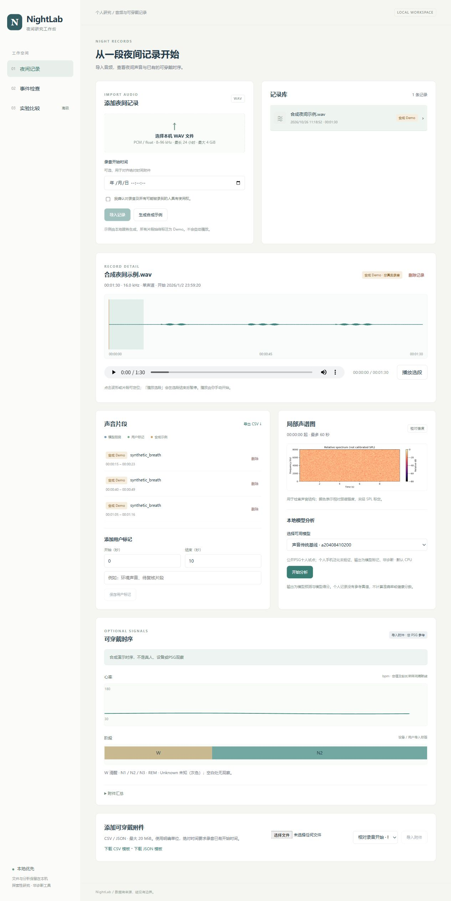
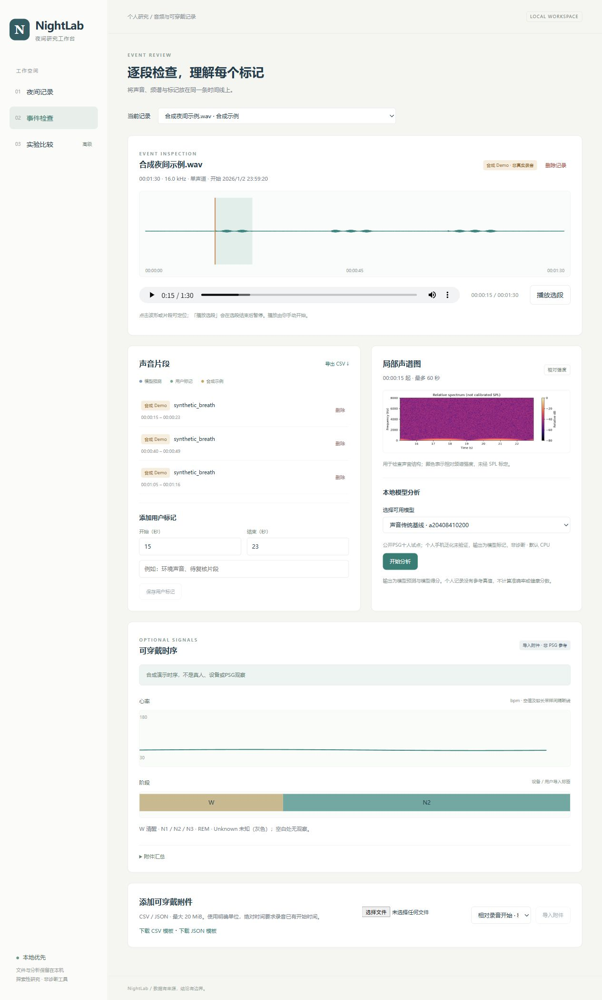
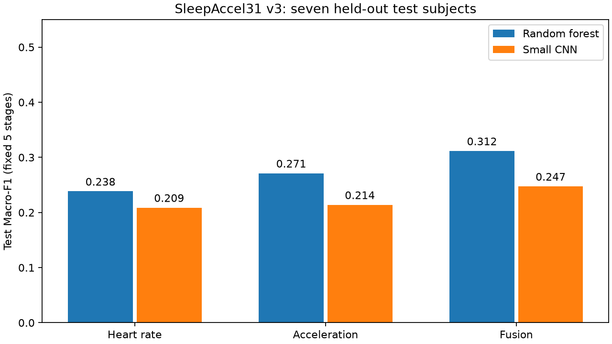
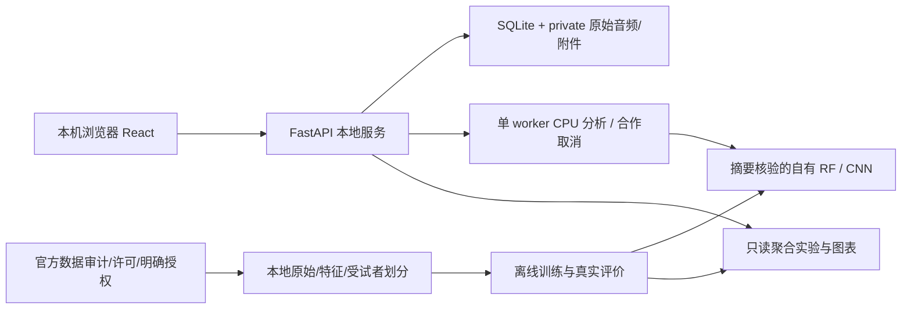

# NightLab

一个本地优先的夜间声音与可穿戴睡眠时序研究工作台：导入、复核和比较真实 AI 实验。研究用途，不用于医学诊断。

当前已实现 React + FastAPI + SQLite 本地应用、声音 RF/CNN、SleepAccel 31 人 RF/CNN 消融，以及完整合成干扰/滤波/增强对照。主声音候选出现时间对齐冲突后冻结，声音路线使用经过校验的 PSG-Audio。负面结果与限制保留。



## 在 Windows 上运行

需要 Windows AMD64、Python 3.12 和已安装的 Node.js/npm。本机已验证 Python 3.12.10、Node 24.22.1、npm 11.19.1。PowerShell 在仓库目录执行：

```powershell
.\scripts\setup_app.ps1
.\scripts\start_app.ps1
```

浏览器打开 **http://127.0.0.1:8766**，点击“生成合成示例”，或选择有权使用的 WAV 并确认同意。安装过程使用哈希锁定的 CPU/API 依赖与 npm lockfile；默认不安装 Torch、不下载数据集或模型，启动脚本不联网安装。结束时在运行终端按 Ctrl+C。已有端口会拒绝启动，不终止其他项目。

新环境即使没有研究数据和模型，也能生成 Demo、导入/播放音频、浏览波形和谱图、导入可穿戴附件、添加/导出用户标记与确认删除。研究模型权重不进 Git；模型未准备时界面明确显示不可用。已登记聚合实验与图表可直接查看。模型训练与自有权重收据说明见 [安装指南](docs/INSTALLATION.md)，不能导入未知 pickle 冒充可信模型。

## 工作台

- **夜间记录**：WAV/WAVEX/RF64、PCM/float，8–96 kHz、单/双声道、最大 4 GiB/24 小时。上传进度/取消、坏文件拒绝、秒级开始时间、波形与可穿戴时间轴。
- **事件检查**：本地播放器、选段播放与结束暂停、局部声谱图、用户标记、真实模型任务进度/取消、事件得分及权重版本、CSV 导出。模型标记与用户观察分别标明。
- **可穿戴附件**：通用 UTF-8 CSV/JSON、模板、相对秒/Unix 秒或毫秒/带时区 ISO。Unknown、空值和采样缺口保留；只有整夜汇总时仅展示汇总。并列显示不等于多模态融合。
- **实验比较**：读取实际完成的聚合 JSON、混淆矩阵与抗噪曲线，参数折叠显示，不伪造运行按钮或个人准确率。
- **本地数据管理**：默认 private/app，确认后删除记录目录和 SQLite 关联附件/标记/任务；活动分析先安全停止。无云上传和遥测。



## 研究结果与边界

| 任务 / 模型 | 受试者划分 | 测试 Macro-F1 | 测试平衡准确率 |
|---|---|---:|---:|
| 声音多数类 | 10 人，6/2/2 | 0.4528 | 0.5000 |
| 声音 RF | 同上 | 0.5960 | 0.6781 |
| 声音 CNN | 同上 | 0.5438 | 0.5613 |
| 可穿戴多数类 N2 | 31 人，18/6/7 | 0.1285 | 0.2000 |
| 可穿戴 RF 心率 / 加速度 / 融合 | 同上 | 0.2384 / 0.2712 / 0.3116 | 0.2567 / 0.3027 / 0.3354 |
| 可穿戴 CNN 心率 / 加速度 / 融合 | 同上 | 0.2088 / 0.2139 / 0.2474 | 0.2446 / 0.2605 / 0.2603 |

声音预测目标为 PSG 参考呼吸事件相关窗口，不是逐声鼾声人工标签，也不是诊断。10 秒窗/5 秒步长，只有明确标签参与监督。连续事件使用预先固定的 5 秒网格、0.5 阈值与一对一 IoU≥0.5：RF 测试 F1 **0.1156**、误报 **40.5 次/小时**；CNN F1 **0.0637**、误报 **35 次/小时**（两位测试者各一小时）。漏检和误报都多，不能可靠定位个人事件。

抗噪完整覆盖 white/hum、−5/0/5/10 dB 和四个相同缩放分支。增强 CNN 在未缩放观测上的窗口 Macro-F1 为 0.5664，高于原始重复控制 0.5419，但事件 F1 为 0.0970，低于控制 0.1304；白噪声 0/5/10 dB 仅检出 3/6/1 个参考事件（共 82），滤波后仍全漏。增强和滤波均没有全面改善。“未额外注噪”不是已知无噪声的干净声源，合成干扰也不等于宿舍录音。

31 人扩展的 93 个目标文件全部匹配官方摘要，得到 26,773 个已评分 30 秒 epoch。划分在训练前冻结，旧三人只进新训练集；v3 规范化依据原始行序审计和作者代码，不插值或猜时钟。三个 CNN 均低于对应 RF。六模型分别完成保存加载与一次 seed42 从头复跑，概率/指标/权重完全一致；这是同种子计算复现，未做跨种子置信区间。七名测试者的相关 epoch 不等于数千名独立受试者。



原三人 1/1/1 试点报告保持冻结，其划分与新 31 人实验不同，不能直接比较成效果提升。详细参数、各阶段 F1、失败案例与来源：

- [实验总记录](docs/EXPERIMENTS.md)、[31 人完整结果](docs/WEARABLE31_RESULTS.md)
- [Phase2 验收](docs/PHASE2_ACCEPTANCE.md)、[事件协议](docs/EVENT_PROTOCOL.md)、[抗噪协议](docs/NOISE_PROTOCOL.md)、[增强控制](docs/NOISE_AUGMENTATION_PROTOCOL.md)
- [v3 数据规范化与旧三人精确兼容](docs/WEARABLE_CLEANING_V3.md)

## 架构与数据



声音：PSG-Audio V3，CC BY 4.0，10 人各第二小时，20 个文件约 7.11 GB；主候选 ScienceDB19070 V5 的时间冲突保留证据。可穿戴：SleepAccel PhysioNet 1.0.0，ODC-By 1.0，已授权 ZIP 精确 576,850,847 字节，已验收 HR/motion/labels 31×3 文件；steps 未提取。BIDSleep 保留可选，不下载全量。

先看 [数据审计](docs/DATA_AUDIT.md)、[数据许可/正式引用及资助致谢](docs/DATASETS.md)、[获取计划](docs/WEARABLE_EXPANSION_PLAN.md)。数据获取默认 dry-run，其他机器/新清单仍要先审计预算；启动应用不会触发下载。

```powershell
.venv\Scripts\python.exe -m scripts.datasets plan --dataset psg-audio-pilot-10
.venv\Scripts\python.exe -m scripts.datasets.sleepaccel_archive
.venv\Scripts\python.exe -m scripts.datasets plan --dataset sleepaccel-cohort-31
```

其他机器的归档入库收据含当地路径/耗时，需在新克隆中按[可迁移收据绑定](docs/PORTABLE_REPRODUCTION.md)验证并绑定当地真实收据，不能复制本机私有收据或改已有实验。

取得明确授权并校验后，传统训练入口支持新 run 名：

```powershell
.venv\Scripts\python.exe -m scripts.train.baselines --corpus data/processed/psg-audio-pilot-10/corpus.json --run-name my-audio-rf
.venv\Scripts\python.exe -m scripts.train.baselines --corpus data/processed/sleepaccel-cohort-31/corpus.json --run-name my-wearable-rf
```

经典流程无需 CUDA。可选 CNN 安装见 [安装指南](docs/INSTALLATION.md) 和 [深度协议](docs/DL_PROTOCOL.md)，大 Torch 轮子不得未经授权下载。31 人固定 CUDA 批次为 `python -m scripts.train.wearable31 --execute`，**只在明确 GPU 窗口运行**，会拒绝覆盖已有 run；不带参数只核验。平时 GPU 多项目共享，CPU 线程最多 2、准备 worker1，不改系统电源或其他项目，没有跨项目自动队列。

## 验收、隐私与交付

本次完整 Python 套件 **504 passed、117 subtests passed、4 Windows 符号链接权限 skip**；前端 typecheck/lint/build 通过。独立 CPU venv 与前端副本安装通过，pip check 通过，无 Torch/模型路径实际导入与删除成功；不是空缓存新电脑实测。隐藏浏览器用合成文件完成真实上传、RF/CNN 推理、静音播放、附件/跨午夜、CSV 与关联删除，见 [软件验收记录](docs/PHASE3_ACCEPTANCE.md)。

```powershell
.venv\Scripts\python.exe -m pytest -q
npm --prefix frontend run typecheck
npm --prefix frontend run lint
npm --prefix frontend run build
```

个人原始录音、手表、数据库、模型、逐窗预测和私有日志都被忽略。必须取得所有可能被录到者同意；个人数据没有 PSG 真值时只用于探索，不计算个人准确率或健康分数。当前没有真人手机/手表采集验证、真实宿舍噪声、跨设备泛化或临床验证；Android 录音与长上下文模型为可选扩展。删除的范围与文件系统限制见 [隐私说明](docs/PRIVACY.md)。

自写软件采用 [MIT](LICENSE)，第三方依赖和数据各自许可；公开仓库不包含原始数据/权重。引用软件用 [CITATION.cff](CITATION.cff)，数据仍需单独署名。提交改进时请附实际复现步骤、来源/许可和必要检查，不提交个人或临床原始文件。

[原始任务书](docs/PROJECT_SPEC.md) · [决策记录](docs/DECISIONS.md) · [架构](docs/ARCHITECTURE.md) · [真实开发历史](docs/PROJECT_LOG.md) · [中文答辩稿](docs/DEFENSE_ZH.md) · [当前接续入口](docs/WORK_STATE.md)
