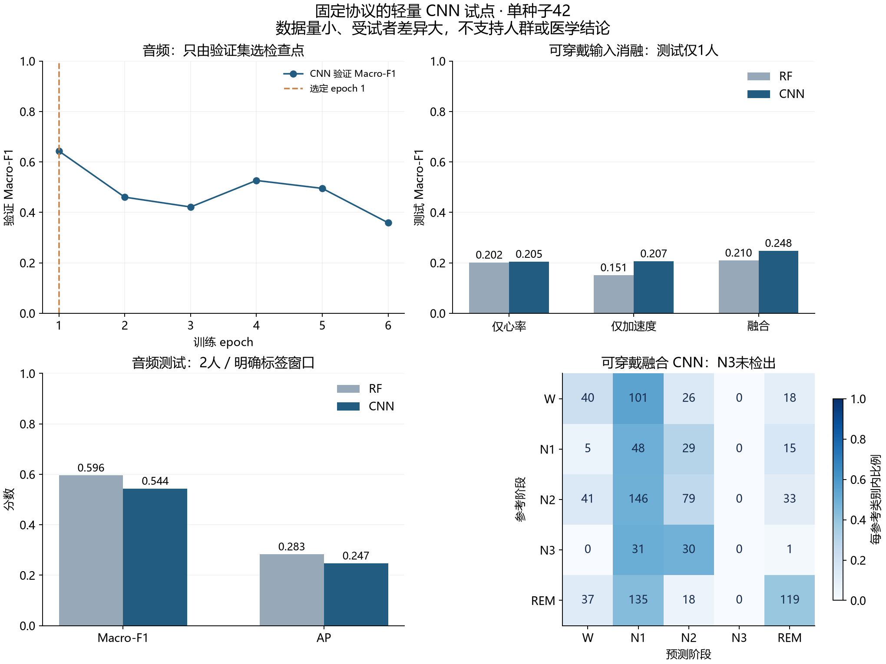
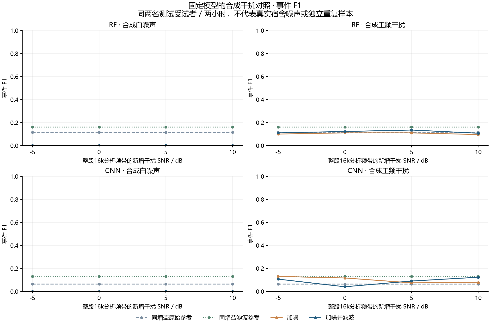

# NightLab

本地优先的夜间声音与可穿戴睡眠时序研究工作台。研究用途，不用于医学诊断。

**当前：传统基线、轻量CNN、连续声音事件与合成干扰/滤波/增强的真实试点已跑通。** 正在进入本地软件主流程，产品UI仍待完成。声音主候选发现时间对齐冲突后冻结，当前声音使用已校验的PSG-Audio。

## 真实试点结果

| 任务/模型 | 参与者与划分 | 测试Macro-F1 | 测试平衡准确率 |
|---|---|---:|---:|
| 声音多数类 | 10人，6/2/2 | 0.453 | 0.500 |
| 声音随机森林 | 同上 | 0.596 | 0.678 |
| 声音CNN | 同上 | 0.544 | 0.561 |
| 可穿戴多数类 | 3人，1/1/1 | 0.096 | 0.200 |
| 可穿戴随机森林 | 同上 | 0.210 | 0.251 |
| 可穿戴CNN融合 | 同上 | 0.248 | 0.272 |

音频任务是PSG参考呼吸事件相关窗口分类；10秒窗、5秒步长，有明确标签的窗口才参与监督评价。RF目标窗Precision仅0.302，误报仍多。可穿戴仅一人训练，N1/N3识别很弱，结果不支持人群或医疗准确率结论。
[完整参数、输入消融、错误分析与真实JSON](docs/EXPERIMENTS.md)。未编辑分数或隐藏负面结果。

对固定声音模型做整小时连续推理后，RF测试事件Precision=0.1099、Recall=0.1220、F1=0.1156，误报40.5次/小时（测试2人各1小时，TP/FP/FN=10/81/72）。这比窗口分类困难得多，当前不能可靠定位事件。规则在计算前固定为5秒网格、概率阈值0.5、一对一IoU≥0.5；[协议与限制](docs/EVENT_PROTOCOL.md)和负面结果全部保留。

CNN同协议测试事件F1=0.0637、误报35次/小时、召回0.0610，整体弱于RF；可穿戴CNN融合仍未检出N3。四个CNN均完成同种子复跑，权重张量、概率、训练/验证历史及最终指标完全一致；这证明计算复现，不是独立种子或人群验证。心率/加速度/融合全部消融与失败案例见实验记录。

抗噪的[固定协议](docs/NOISE_PROTOCOL.md)、实际SNR/无削波及完整四模型对照已完成。原始RF/CNN和原始重复CNN在白噪声四SNR下固定阈值均不检出事件；增强CNN只在0/5/10dB分别检出3/6/1个参考事件（总82），滤波后仍全漏。增强未缩放窗口Macro-F1=.5664，高于原始重复控制.5419，但事件F1低于该控制，不能称全面改善。全部条件和不同早停更新数完整公开。白噪声/工频为合成干扰，不代表真实宿舍声；“干净”只指未额外注入干扰的原始观测。






SleepAccel31人扩展已单独批准，[具体预算与新划分](docs/WEARABLE_EXPANSION_PLAN.md)保留逐文件清单；当前ZIP获取与逐文件验收尚未完成，表中仍是三人试点分数。不会把“批准下载”当作“数据到齐”或“泛化提高”。

## Windows CPU环境

当前锁定Windows AMD64 / CPython3.12。所有wheel SHA256与PyPI官方元数据核对；安装首先使用清华镜像，失败回退官方。独立venv，不修改全局Python。

```powershell
.\scripts\setup_cpu.ps1
.venv\Scripts\python.exe -m pytest -q
```

NumPy/SciPy/scikit-learn用于经典算法，Matplotlib用于真实科研图表。经典基线保持CPU可运行；轻量CNN使用可选PyTorch，当前已验证CPU路径和RTX5060 CUDA12.8路径。无模型API调用或启动自动下载权重。

2026-10-25用户已恢复GPU窗口与满功率供电，本轮允许单进程轻量CNN训练；平时多项目共享GPU，默认仍需明确窗口。准备默认1个worker、数值线程最多2；不改变系统电源计划或其他项目进程，也没有自动跨项目GPU排队器。

可选CUDA环境使用[官方PyTorch2.9.1 CUDA12.8轮子](https://download.pytorch.org/whl/cu128/torch/)和哈希锁定的小依赖。运行`.\scripts\setup_deep.ps1`，默认要求`data/raw/environment/wheels/`下已有核验轮子或传`-LocalTorchWheel`；缺失时会先显示约2.86GB大小并停止，取得明确下载授权后才能用`-AllowTorchDownload`。本机复用了官方SHA256相同的pip缓存，没有重新下载该大包。不要复制其他项目的site-packages。当前模型与训练协议见[DL_PROTOCOL.md](docs/DL_PROTOCOL.md)。

已提交的图表和聚合JSON可直接查看，无需下载原始数据。重绘声音图表可运行：

```powershell
.venv\Scripts\python.exe -m scripts.evaluate.plot_baselines --metrics docs/results/psg-rf-pilot-v1.json --output artifacts/experiments/psg-rf-pilot-v1
```

## 数据与复现

先完整阅读[数据审计](docs/DATA_AUDIT.md)、[许可与引用](docs/DATASETS.md)及[隐私说明](docs/PRIVACY.md)。原始数据、派生特征、模型和完整runs均gitignored；本仓库只公开代码、元信息与聚合研究结果。

以下命令默认只展示计划：

```powershell
python -B -m scripts.datasets plan --dataset psg-audio-pilot-10
python -B -m scripts.datasets.fetch_manifest --dataset psg-audio-pilot-10
python -B -m scripts.datasets prepare --dataset sleepaccel
```

只有明确授权后才加--execute和适用的--confirm-large-download。十人声音计划共约7.11GB，当前实例的追加6.40GB已获单独授权；其他机器首次获取需完整预算。可穿戴当前只有三人试点，不在启动时取完整数据。

数据取得并核验后，在仓库根目录运行：

```powershell
.venv\Scripts\python.exe -m scripts.datasets.prepare_cohort --dataset psg-audio-pilot-10 --execute --workers 1
.venv\Scripts\python.exe -m scripts.datasets.prepare_cohort --dataset sleepaccel-pilot-3 --execute --workers 1 --feature-tag features-v2 --no-reuse-pilot
.venv\Scripts\python.exe -m scripts.train.baselines --corpus data/processed/psg-audio-pilot-10/corpus.json --run-name my-audio-run
.venv\Scripts\python.exe -m scripts.train.baselines --corpus data/processed/sleepaccel-pilot-3/corpus.json --run-name my-wearable-run
```

新环境没有早期pilot缓存时会重新准备数据；已有相同产物可校验复用，冲突则拒绝覆盖。可穿戴旧v1产物与v2策略分开，详见[重复块与质量记录](docs/WEARABLE_CLEANING.md)。样本获取、完整性、退出码、取消/续传和准备说明见[scripts/datasets](scripts/datasets/README.md)。

当前本机冻结声音基线及其可信模型摘要在本地保留，可运行连续评价（不重训）：

```powershell
$env:OMP_NUM_THREADS='2'; $env:MKL_NUM_THREADS='2'; $env:OPENBLAS_NUM_THREADS='2'
.venv\Scripts\python.exe -m scripts.datasets.dense_audio
.venv\Scripts\python.exe -m scripts.datasets.dense_audio --execute
.venv\Scripts\python.exe -m scripts.evaluate.audio_events --run-name my-event-run
.venv\Scripts\python.exe -m scripts.evaluate.event_failures --input runs/my-event-run/events.json --output runs/my-event-run/failures.json
```

第一条只显示计划；执行时补齐固定验证/测试四人的连续特征。评价器只加载此前已记录摘要的本机自建模型，不下载权重。新环境需先复现基线并核验自建保存/加载一致性、登记新摘要；不能将未知joblib或外部权重写入可信清单冒充本机模型。已公开的聚合结果与图表可直接查看。

安装可选PyTorch并准备已授权数据后，CNN命令如下。`--device`默认CPU；只有明确GPU窗口时才传cuda。新run名不会覆盖已有结果。

```powershell
.venv\Scripts\python.exe -m scripts.datasets.deep_cache --task audio
.venv\Scripts\python.exe -m scripts.datasets.deep_cache --task audio --execute
.venv\Scripts\python.exe -m scripts.datasets.deep_cache --task wearable --execute
.venv\Scripts\python.exe -m scripts.train.cnn --task audio --run-name my-audio-cnn --device cuda
.venv\Scripts\python.exe -m scripts.train.cnn --task wearable --run-name my-wearable-cnn --feature-set all --device cuda
.venv\Scripts\python.exe -m scripts.evaluate.cnn_events --run-name my-audio-cnn --output-name my-cnn-events
```

可穿戴另外运行`--feature-set heart_rate`和`acceleration`，需使用不同run名。`--smoke`只跑5个训练batch和validation，不产生test结果。输入准备重新验证官方原始/经典缓存，训练入口再次核验当前来源；归一化/类别权重仅拟合train，检查点仅按validation选取。学习统计、权重、逐窗预测保持本地，公共JSON保留汇总分数及来源摘要。

噪声缓存默认只展示计划；`pilot`仅固定训练录音用于预算，`test`必须全部16个录音条件完成才可评分。冻结RF/CNN不重训，使用相同训练归一化。

```powershell
.venv\Scripts\python.exe -m scripts.datasets.noise_features --scope pilot
.venv\Scripts\python.exe -m scripts.datasets.noise_features --scope test --execute
.venv\Scripts\python.exe -m scripts.evaluate.noise --run-name my-noise-evaluation --device cuda
```

该CPU测试特征准备本次约10分钟，增强副本约12分钟、数值两线程/单worker，提前检查RAM并预留2GiB；不写整夜混合WAV。增强训练与等样本量控制的[预先固定方案](docs/NOISE_AUGMENTATION_PROTOCOL.md)均实际运行并复跑，证据和限制在实验记录。原始3人/10人授权与本次31人授权有明确范围，其他机器获取数据仍须先审计预算。

```powershell
.venv\Scripts\python.exe -m scripts.datasets.noise_augmentation --execute
.venv\Scripts\python.exe -m scripts.train.audio_augmentation --mode clean_duplicate --run-name my-clean-duplicate --device cuda
.venv\Scripts\python.exe -m scripts.train.audio_augmentation --mode noise_augmented --run-name my-noise-augmented --device cuda
```

新模型必须先完成保存/加载、固定种子复跑和自有权重摘要登记，再由可信模型入口评价。当前本机预设的augmentation评价绑定已公开的repro收据，不能用未知权重替换来冒充复现。

## 研究与工程文档

- [原始任务书](docs/PROJECT_SPEC.md)、[决策与调整](docs/DECISIONS.md)
- [Phase0最小数据验收](docs/PHASE0_ACCEPTANCE.md)、[Phase1试点验收](docs/PHASE1_ACCEPTANCE.md)
- [Phase2算法/抗噪试点验收](docs/PHASE2_ACCEPTANCE.md)，软件主流程与31人扩展仍继续
- [声音主候选时间冲突](docs/SOUND_AUDIT.md)、[PSG实际样本](docs/PSG_AUDIT.md)
- [可穿戴审计](docs/WEARABLE_AUDIT.md)、[标签映射](docs/LABEL_MAPPING_EVIDENCE.md)
- [当前架构](docs/ARCHITECTURE.md)、[研究方案](docs/RESEARCH_PLAN.md)、[实验](docs/EXPERIMENTS.md)
- [真实开发记录](docs/PROJECT_LOG.md)

声音和可穿戴独立训练、独立评价。并列时间轴不等于多模态融合；个人录音与手表没有参考标签时只能用于探索，不能进入正式准确率报告。后续再实现本地API、夜间记录/事件检查/实验比较界面、个人数据导入删除与真实UI截图。
