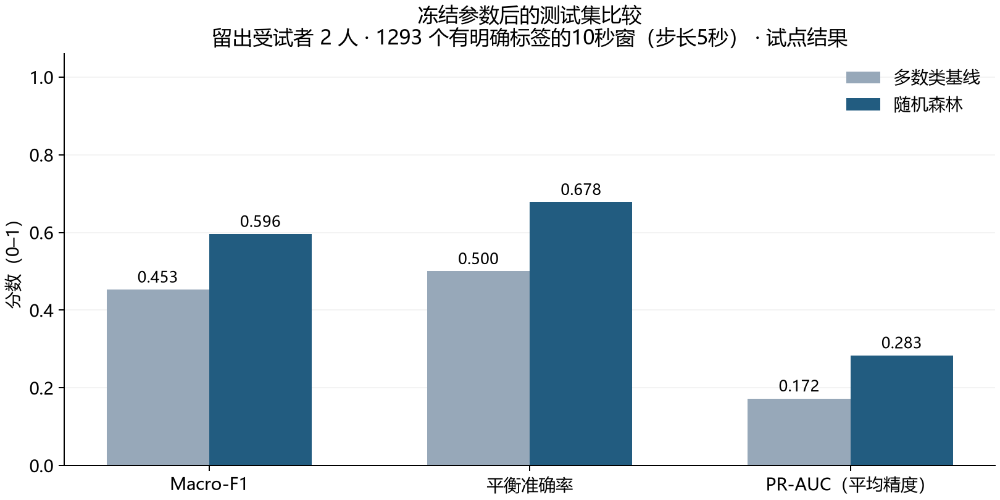

# NightLab

本地优先的夜间声音与可穿戴睡眠时序研究工作台。研究用途，不用于医学诊断。

**当前：两条传统机器学习基线的真实试点流程已跑通。** 尚无产品UI、深度学习或抗噪结论。声音主候选发现时间对齐冲突后冻结，当前声音基线使用已校验的PSG-Audio。

## 真实试点结果

| 任务/模型 | 参与者与划分 | 测试Macro-F1 | 测试平衡准确率 |
|---|---|---:|---:|
| 声音多数类 | 10人，6/2/2 | 0.453 | 0.500 |
| 声音随机森林 | 同上 | 0.596 | 0.678 |
| 可穿戴多数类 | 3人，1/1/1 | 0.096 | 0.200 |
| 可穿戴随机森林 | 同上 | 0.210 | 0.251 |

音频任务是PSG参考呼吸事件相关窗口分类；10秒窗、5秒步长，有明确标签的窗口才参与监督评价。RF目标窗Precision仅0.302，误报仍多。可穿戴仅一人训练，N1/N3识别很弱，结果不支持人群或医疗准确率结论。
[完整参数、输入消融、错误分析与真实JSON](docs/EXPERIMENTS.md)。未编辑分数或隐藏负面结果。



## Windows CPU环境

当前锁定Windows AMD64 / CPython3.12。所有wheel SHA256与PyPI官方元数据核对；安装首先使用清华镜像，失败回退官方。独立venv，不修改全局Python。

```powershell
.\scripts\setup_cpu.ps1
.venv\Scripts\python.exe -m pytest -q
```

NumPy/SciPy/scikit-learn用于当前算法，Matplotlib只用于真实科研图表；当前训练仅使用本地CPU，无模型API调用、启动自动下载权重或CUDA要求。深度学习依赖在后续核对驱动后安装。

已提交的图表和聚合JSON可直接查看，无需下载原始数据。重绘声音图表可运行：

```powershell
.venv\Scripts\python.exe -m scripts.evaluate.plot_baselines --metrics docs/results/psg-rf-pilot-v1.json --output artifacts/experiments/psg-rf-pilot-v1
```

## 数据与复现

先完整阅读[数据审计](docs/DATA_AUDIT.md)、[许可与引用](docs/DATASETS.md)及[隐私说明](docs/PRIVACY.md)。原始数据、派生特征、模型和完整runs均gitignored；本仓库只公开代码、元信息与聚合研究结果。

以下命令默认只展示计划：

```powershell
python -B -m scripts.datasets plan --dataset psg-audio-pilot-10
python -B -m scripts.datasets.fetch_manifest --dataset psg-audio-pilot-10
python -B -m scripts.datasets prepare --dataset sleepaccel
```

只有明确授权后才加--execute和适用的--confirm-large-download。十人声音计划共约7.11GB，当前实例的追加6.40GB已获单独授权；其他机器首次获取需完整预算。可穿戴当前只有三人试点，不在启动时取完整数据。

数据取得并核验后，在仓库根目录运行：

```powershell
.venv\Scripts\python.exe -m scripts.datasets.prepare_cohort --dataset psg-audio-pilot-10 --execute --workers 1
.venv\Scripts\python.exe -m scripts.datasets.prepare_cohort --dataset sleepaccel-pilot-3 --execute --workers 1 --feature-tag features-v2 --no-reuse-pilot
.venv\Scripts\python.exe -m scripts.train.baselines --corpus data/processed/psg-audio-pilot-10/corpus.json --run-name my-audio-run
.venv\Scripts\python.exe -m scripts.train.baselines --corpus data/processed/sleepaccel-pilot-3/corpus.json --run-name my-wearable-run
```

新环境没有早期pilot缓存时会重新准备数据；已有相同产物可校验复用，冲突则拒绝覆盖。可穿戴旧v1产物与v2策略分开，详见[重复块与质量记录](docs/WEARABLE_CLEANING.md)。样本获取、完整性、退出码、取消/续传和准备说明见[scripts/datasets](scripts/datasets/README.md)。

## 研究与工程文档

- [原始任务书](docs/PROJECT_SPEC.md)、[决策与调整](docs/DECISIONS.md)
- [Phase0最小数据验收](docs/PHASE0_ACCEPTANCE.md)、[Phase1试点验收](docs/PHASE1_ACCEPTANCE.md)
- [声音主候选时间冲突](docs/SOUND_AUDIT.md)、[PSG实际样本](docs/PSG_AUDIT.md)
- [可穿戴审计](docs/WEARABLE_AUDIT.md)、[标签映射](docs/LABEL_MAPPING_EVIDENCE.md)
- [当前架构](docs/ARCHITECTURE.md)、[研究方案](docs/RESEARCH_PLAN.md)、[实验](docs/EXPERIMENTS.md)
- [真实开发记录](docs/PROJECT_LOG.md)

声音和可穿戴独立训练、独立评价。并列时间轴不等于多模态融合；个人录音与手表没有参考标签时只能用于探索，不能进入正式准确率报告。后续再实现本地API、夜间记录/事件检查/实验比较界面、个人数据导入删除与真实UI截图。
