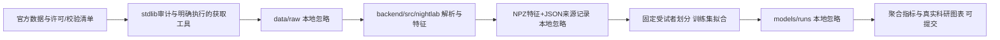

# 研究流程与本地软件架构

更新：2026-10-24。当前实现算法包和离线CLI，尚未实现FastAPI、React界面或SQLite记录索引。

## 当前边界

- scripts/datasets保留Python标准库审计/获取路径，默认dry-run。实际准备特征时才加载已安装的算法包；无启动自动下载。
- backend/src/nightlab/audio负责EDF分通道窗口读取、RML参考事件、重采样和RMS/log-mel特征。读取固定ADC量程做数值转换，不拟合人群统计量，也不声称声压校准。
- wearable负责SleepAccel格式、原始/规范阶段、30秒特征与缺口统计；未评分掩码保留。重复块处理是明确配置，默认拒绝时间回退。
- experiments负责受试者划分、训练集填补器、多数类/RF及指标。模型不接收subject_id作为输入特征。整个受试者只能在一个集合。
- scripts/train以完整corpus.json为入口，缺少计划中的参与者则拒绝评价。模型权重只保存本地models，输出不会自动上传。
- scripts/evaluate从已记录指标生成PNG/SVG图，图有来源文件SHA256。科研图不是UI截图。

## 内部准备格式

features.npz使用无object数组，np.load必须allow_pickle=False；记录X、y、subject_id、区间等。timeline.npz保留所有窗口/epoch及目标有效性，不能把无标签位置补成真实类别。
metadata.json记录来源版本、原始文件完整性、特征定义/单位、代码SHA256、依赖版本、运行时间、缺失数量与产物摘要。训练输出另外记录模型参数、种子、固定划分和每类支持数。

初期选择NPZ+JSON而不是Parquet，以减少安装依赖；当前特征规模较小且无复杂查询。后续API阶段用SQLite建立记录/实验索引，并导入这些来源记录，不替换原始追踪信息。这是分阶段实现，不代表SQLite已完成。

## 环境与后续

采用本机已安装的CPython3.12 AMD64，因此当前hash锁只覆盖Windows AMD64/Python3.12；不能把它直接当作跨平台锁。清华镜像解析的所有wheel均对照官方PyPI版本元数据验证SHA256，锁中包含运行、测试、构建和绘图依赖。

当前CPU流程无需PyTorch/CUDA。Phase2安装深度学习依赖前再核查驱动/设备及PyTorch官方匹配方案。Phase3实现本地API与简洁React界面，普通夜间记录与高级实验分开；个人曲线保留缺失，训练特征填补不变成“实测生理值”。
