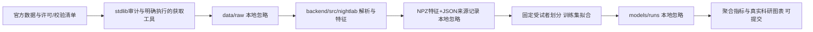

# 研究流程与本地软件架构

更新：2026-10-26。当前同时具备离线研究流程和React/FastAPI/SQLite本地应用。

## 当前边界

- scripts/datasets保留Python标准库审计/获取路径，默认dry-run。实际准备特征时才加载已安装的算法包；无启动自动下载。
- backend/src/nightlab/audio负责EDF分通道窗口读取、RML参考事件、重采样和RMS/log-mel特征。读取固定ADC量程做数值转换，不拟合人群统计量，也不声称声压校准。
- wearable负责SleepAccel格式、原始/规范阶段、30秒特征与缺口统计；未评分掩码保留。重复块处理是明确配置，默认拒绝时间回退。
- experiments负责受试者划分、训练集填补器、多数类/RF及指标。模型不接收subject_id作为输入特征。整个受试者只能在一个集合。
- deep负责真实log-mel/1Hz可穿戴张量、观测mask、训练集标准化、小CNN和验证集检查点。GroupNorm无运行批统计，模型不包含患者身份；默认CPU，明确窗口才选CUDA。CPU state_dict保存后weights_only加载核验，权重/学习统计不公开。
- deep_cache保留音频全部窗口供连续推理，但监督mask继续排除不明确窗口。准备和训练入口都复核当前原始文件、经典缓存、代码及张量摘要；失败不发布假complete索引。
- scripts/train以完整corpus.json为入口，缺少计划中的参与者则拒绝评价。模型权重只保存本地models，输出不会自动上传。
- scripts/evaluate从已记录指标生成PNG/SVG图，图有来源文件SHA256。科研图不是UI截图。

## 内部准备格式

features.npz使用无object数组，np.load必须allow_pickle=False；记录X、y、subject_id、区间等。timeline.npz保留所有窗口/epoch及目标有效性，不能把无标签位置补成真实类别。
metadata.json记录来源版本、原始文件完整性、特征定义/单位、代码SHA256、依赖版本、运行时间、缺失数量与产物摘要。训练输出另外记录模型参数、种子、固定划分和每类支持数。

深度输入inputs.npz使用values[N,32,100]（音频）或values[N,5,30]+masks[N,2,30]（wearable），带y、supervised_mask、subject_id和起止秒。缺失保留NaN直到训练集标准化，未评分音频y为空串；不把空串当背景。CNN逐窗概率保存在本地runs/predictions.npz，事件评价必须覆盖整个held-out录音，不能只用明确标签窗口。公共summary删除概率、时间轴、matches及学习到的均值/尺度。

初期选择NPZ+JSON而不是Parquet，以减少安装依赖；当前特征规模较小且无复杂查询。应用SQLite保存个人记录/附件/标记与任务；公共实验走受控只读JSON与PNG登记，不把所有离线数组复制入SQLite。来源记录保持原状。

## 环境与后续

采用本机已安装的CPython3.12 AMD64，因此当前hash锁只覆盖Windows AMD64/Python3.12；不能把它直接当作跨平台锁。清华镜像解析的所有wheel均对照官方PyPI版本元数据验证SHA256，锁中包含运行、测试、构建和绘图依赖。

经典CPU流程无需PyTorch/CUDA。深度路径另用hash锁定的PyTorch2.9.1+cu128与8个小依赖，官方摘要与本机缓存一致后复用；CPU合成训练测试和真实RTX5060 CUDA训练均已执行。跨平台/跨硬件逐位复现未验证。Phase2的抗噪/滤波/增强及等样本量控制已完成。Phase3普通夜间记录与高级实验分开，个人曲线保留缺失，训练特征填补不变成“实测生理值”。

## 本地应用实现

`api/app.py`只负责HTTP契约、验证、响应和静态构建；`services/records.py`管理知情同意与受控私有文件生命周期，`media.py`独立检查RIFF/RF64容器并流式完整解码；`storage/repository.py`为每个操作建立SQLite事务与外键级联。`services/wearable_import.py`解析通用CSV/JSON，不猜厂商阶段编码，不按标签或结果修复时钟。

`services/jobs.py`只有一个后台worker，校验导入SHA后批量读取窗口，调用`model_registry.py`。RF从自建可信摘要收据验证后才joblib加载，CNN以weights_only加载并核源码/环境/训练统计收据。应用推理明确CPU；没有训练数据也能运行已核验权重。任意尾长补最后一个完整10秒窗口，再用冻结事件解码覆盖至文件结束；短于10秒只浏览与标记。个人数据不会形成正式评估集。

取消在批次/窗口之间合作检查，完整事件与完成状态在一个DB事务发布；未完成时保留原有模型结果和用户标记。重启将失去执行器的活动任务标记失败，可重新提交；不保存虚构的进度。文件系统删除与DB提交的边界详见PRIVACY.md。

前端`frontend/src/views`分为Records、RecordViewer、Experiments，Signals绘制波形/阶段/心率/加速度。真实XHR上传进度，轮询真实job状态；播放器与选段、谱图联动，选段结束暂停。开始时间读取本机datetime字段，转换成含UTC时区的ISO上传；绝对附件须明确单位及记录起点，跨午夜按真实timestamp相减。

生产构建由FastAPI同源提供，只监听127.0.0.1；开发Vite5178代理8766。默认private/app可覆盖为本机NIGHTLAB_DATA_DIR；一台实例仅单服务worker，启动脚本探测占用，不管理其他项目。API和SQLite测试、实际浏览器和新CPU环境分别记录，不混为临床或真实设备验收。

## 31人扩展隔离

新`cleaning_v3.py`、`prepare_sleepaccel31.py`、`train/wearable31.py`绑定独立manifest/corpus和固定18/6/7划分。旧三人源码/cache/model不改；新loader再次核raw官方SHA、来源/数组摘要、身份/时间/缺失mask和旧三人精确兼容。完整结果见WEARABLE31_RESULTS.md。
