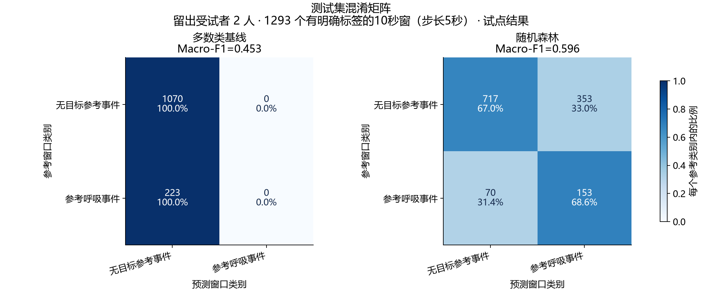
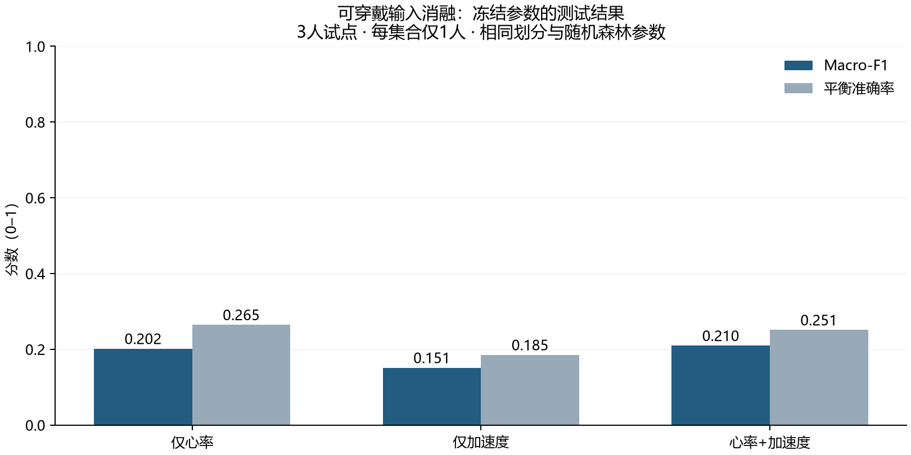
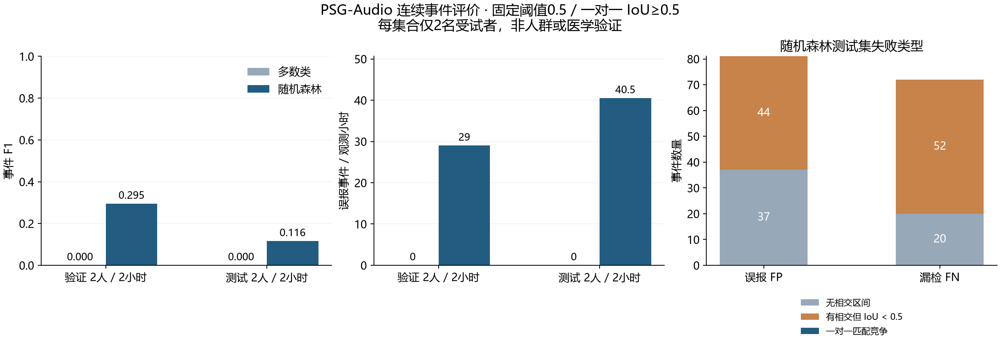

# 实验记录：传统基线试点

运行日期：2026-10-24。结果由真实本地CPU运行产生。当前是小规模流程试点，不是人群或临床验证；没有UI或诊断报告。

## 问题、数据与划分

声音研究公开PSG呼吸参考事件相关的音频窗口；标签不是逐段听音确认的鼾声。采用已授权PSG-Audio V3十人，每人第二小时EDF，共10小时及RML；20文件匹配官方MD5。按身份排序选择最初10名不同受试者，没有按标签或模型结果挑选。
种子42/NumPy PCG64固定6训练/2验证/2测试，先分受试者再处理窗口。训练3775、验证1253、测试1293个有效窗口，共6321；7190候选窗中869个边界/其他呼吸事件窗因目标不明确不进入监督评价。

可穿戴采用SleepAccel固定三人试点，9文件全部匹配官方SHA256。训练8258170（972 epoch）、验证5383425（976）、测试1066528（952），总2900个已评分30秒epoch。同一人没有跨集合。原始3/4统一N3，-1掩码；重复块策略与缺口见WEARABLE_CLEANING.md。

## 参数、特征与模型

声音：Mic原始48kHz，固定ADC满量程换算后以多相滤波重采样16kHz；10秒窗、5秒步长；四类PSG目标事件并集覆盖至少50%为正，任意呼吸事件重叠为零才作背景，其余窗排除。背景标签不表示健康或安静。
67维特征：RMS、过零比例、功率谱质心、32个HTK log-mel均值和32个标准差。分析帧400样本、hop160、FFT512，numpy.hanning对称窗，功率地板1e-12，自然对数。没有预训练权重。

可穿戴13维：心率数量/均值/总体标准差/最小/最大/时间斜率，加速度数量/各轴标准差/模长均值/标准差/MAD；同时保留缺口统计。计数特征的采样密度风险被记录。

两条路线都运行多数类与随机森林。RF固定200棵树、深度12、叶最少3样本、balanced_subsample、种子42、CPU单任务；缺失值填补只拟合训练数据。没有搜索超参数或按测试结果选阈值。下列可穿戴输入消融来自原任务书预先要求，全部报告。

## 真实结果

| 任务/模型 | 验证Macro-F1 | 测试Macro-F1 | 测试平衡准确率 | 测试PR-AUC/AP |
|---|---:|---:|---:|---:|
| 声音多数类 | 0.4294 | 0.4528 | 0.5000 | 0.1725 |
| 声音RF | 0.5395 | 0.5960 | 0.6781 | 0.2833 |
| 可穿戴多数类 | 0.1144 | 0.0956 | 0.2000 | 不适用 |
| 可穿戴RF融合 | 0.1295 | 0.2096 | 0.2509 | 不适用 |

PR-AUC这里使用average precision，不是梯形面积。Macro-F1按固定类别列表计算，每类支持数与混淆矩阵在原始报告中保留；没有只报告overall accuracy。

可穿戴RF输入消融（同一划分、模型参数和预处理）：

| 输入 | 特征数 | 验证Macro-F1 | 测试Macro-F1 | 测试平衡准确率 |
|---|---:|---:|---:|---:|
| 仅心率 | 6 | 0.0864 | 0.2017 | 0.2647 |
| 仅加速度 | 7 | 0.1017 | 0.1513 | 0.1852 |
| 融合 | 13 | 0.1295 | 0.2096 | 0.2509 |

该试点不支持“融合显著更好”的结论。完整真实JSON见docs/results；权重保存在本地models，原始runs保留依赖、参数、划分、特征和来源摘要。

## 错误分析与局限

声音多数类因背景占比高获得0.8275总体准确率，但对223个目标窗召回为0。RF找回153/223个目标窗，同时将353/1070个背景窗误报为正，Precision仅0.3024；当前误报明显。两个测试受试者不足以代表总体，重叠窗口也不是独立样本。

可穿戴融合RF将678/952个测试epoch预测为REM，参考REM为309；N1/N3 F1约0.0198/0.0233。训练仅一人，测试有136个epoch出现缺失特征、采样密度也不同；这些是重要限制，不能以当前结果宣称消费级睡眠分期准确。

以上表格报告有明确标签的窗口/epoch分类；后续连续事件评价见下节，不能把窗口误报数当事件误报/小时。抗噪、深度学习和跨设备验证仍未完成。
后续改善应在训练/验证集或新预注册方案中完成，保留本次冻结结果，不能根据这两位/一位测试分数反复挑模型。

## 复现与核验

1. scripts/setup_cpu.ps1建立Windows AMD64/Python3.12的hash锁定环境；25个wheel对照官方PyPI摘要核验。
2. scripts/datasets先plan/verify，取数据必须明确执行；10人追加批次已由用户单独授权，数据不随仓库发布。
3. prepare/prepare_cohort生成无pickle的NPZ与来源元数据，再运行scripts/train/baselines.py。明确命令见README。
4. 两条融合/声音基线已用相同种子重训，所有记录指标精确一致；自建保存模型加载后的预测与重训模型逐项一致，证据见docs/results/baseline-reproducibility.json。
5. scripts/evaluate从真实指标生成PNG/SVG；未手工修改分数。图表来源摘要保留。

软件环境、完整参数与依赖版本以对应JSON和requirements-cpu.lock为准。研究用途，不提供医学建议或诊断。

## 连续声音事件评价 v1

冻结协议见[EVENT_PROTOCOL.md](EVENT_PROTOCOL.md)。不重训已有模型，重新核验原始输入、旧特征和源码来源，补齐验证/测试共4小时的全部2876个窗口：复用2546个明确监督特征，只补算330个无明确监督标签的特征。四条录音各重算第一个已存窗口，均逐项完全一致。补算窗口仅用于连续推理，不补标签、不改旧窗口分数。

5秒bin内平均覆盖其中心的窗口概率，固定阈值0.5并合并相邻阳性bin；事件一对一IoU≥0.5匹配。分片外参考先裁剪；这四条录音没有边界截断目标。每集合观测2小时，验证104个、测试82个参考事件。以下是按计数与观测时长相加的微平均，不是单人率平均。

| 模型/集合 | TP / FP / FN | Precision | Recall | 事件F1 | 误报/小时 |
|---|---|---:|---:|---:|---:|
| 多数类/验证 | 0 / 0 / 104 | 未定义 | 0 | 0 | 0 |
| 多数类/测试 | 0 / 0 / 82 | 未定义 | 0 | 0 | 0 |
| RF/验证 | 28 / 58 / 76 | 0.3256 | 0.2692 | 0.2947 | 29.0 |
| RF/测试 | 10 / 81 / 72 | 0.1099 | 0.1220 | 0.1156 | 40.5 |

多数类没有预测任何阳性，不能因误报为零声称表现良好。RF测试仅匹配10个事件；在这10个未截断匹配上，起点/终点平均绝对误差分别2.65/5.05秒（带符号均值-2.15/+2.35秒）。漏检的72个事件不在定位误差分母，不能只凭较小定位均值声称定位可靠。

失败分析由实际间隔自动产生：测试81个FP中，37个与任何目标参考均无交集，44个有交集但IoU不足0.5；72个FN中20个与任何预测均无交集，52个有交集但匹配不足。8个预测区间同时相交多个参考，3个参考相交多个预测；这是区间几何现象，不能直接认定为音频里的多个声源或某种医学机制。测试两个受试者的误差并不均衡，逐人计数保留在公共JSON。

窗口Macro-F1=0.5960与事件F1=0.1156衡量不同问题；明确监督窗排除边界不确定区域，而连续评价必须覆盖整小时，且匹配要求时间重合。结果暴露了当前模型的误报、边界与合并/拆分风险，尚不能可靠定位事件。不得依据这两位测试受试者重新挑选阈值以改善本次报告。

本地 `runs/psg-events-pilot-v1/events.json` 保存逐窗/bin概率、区间与匹配供复核，保持Git忽略；公共 `docs/results/psg-events-pilot-v1.json` 仅匿名计数、汇总指标和来源摘要，`psg-events-failures-v1.json` 仅失败分类统计。旧声音报告缺少后来添加的feature_subset字段，本次以完整67个feature_names及feature_count逐项核对确认使用全部输入，没有修改旧报告或模型。

## 2026-10-25：轻量CNN真实试点

训练前固定[DL_PROTOCOL.md](DL_PROTOCOL.md)，没有预训练权重。原始STFT输入7190个32×100图；监督训练/窗口评分仍只用原6321窗，未给869个边界窗伪造标签。可穿戴2900个30秒epoch，每秒5种值和2种观测mask；缺失标准化后补0但保留mask。标准化与类别权重只拟合train，分别对HR、accel、融合三个版本运行。完整结构、seed42、AdamW、batch64、最多20epoch/早停5、FP32参数见协议。

| 模型/输入 | 最佳epoch / 实际epoch | 验证Macro-F1 | 测试Macro-F1 | 测试平衡准确率 | 测试AP |
|---|---|---:|---:|---:|---:|
| 音频CNN | 1 / 6 | 0.6434 | 0.5438 | 0.5613 | 0.2472 |
| 可穿戴CNN/HR | 1 / 6 | 0.0864 | 0.2048 | 0.2557 | 不适用 |
| 可穿戴CNN/accel | 2 / 7 | 0.2488 | 0.2066 | 0.2167 | 不适用 |
| 可穿戴CNN/融合 | 8 / 13 | 0.2103 | 0.2482 | 0.2721 | 不适用 |

音频CNN的测试Macro-F1/AP均低于RF的0.5960/0.2833。CNN训练损失继续下降，但验证最佳在第一轮，此后下降，说明训练拟合与跨受试者效果不一致；这里没有通过延长训练或改测试阈值追回分数。两种流程的表示和优化不同，这不是只改变“深度”的单因素实验。

可穿戴CNN融合测试比RF的0.2096高，但仅一名测试受试者，不能称为显著提高或人群可靠性。融合CNN将461/952个epoch判为N1（参考97），没有预测任何N3，62个参考N3全部漏检；仅HR验证集全判REM，说明该试点跨人迁移仍很弱。三个输入版本全部报告，不只展示最好的融合分数。

音频CNN按同一EVENT_PROTOCOL做全窗口连续推理：

| 模型/集合 | TP / FP / FN | Precision | Recall | 事件F1 | 误报/小时 |
|---|---|---:|---:|---:|---:|
| CNN/验证 | 22 / 40 / 82 | 0.3548 | 0.2115 | 0.2651 | 20.0 |
| CNN/测试 | 5 / 70 / 77 | 0.0667 | 0.0610 | 0.0637 | 35.0 |
| RF/测试（冻结旧结果） | 10 / 81 / 72 | 0.1099 | 0.1220 | 0.1156 | 40.5 |

CNN误报较少但召回更低，不能称为检测改善。CNN测试70个FP中38个无目标参考交集、32个IoU不足；77个FN中40个无预测交集、37个IoU不足。仅5个匹配的起止MAE=4.5/2.2秒，匹配集合不同，不能据终点误差较小断言定位更准。

四个CNN全部真实重复训练一次：权重文件摘要、每个state_dict张量、预测概率、训练损失/验证历史、最佳epoch和最终指标逐项完全一致。每次保存后又独立weights_only加载并比较同设备同batch预测。凭据见`docs/results/cnn-reproducibility-v1.json`。这是同种子计算复现，不是多个独立种子的统计验证。

元数据修正：首次本地报告把输入缓存版本deep-inputs-v1写入dataset_version，发现后修正runner，复跑报告分别记录数据源V3/PhysioNet1.0.0与input_version；训练结构、参数、划分和结果未变，首次报告留在本地供对照，没有手改指标。公共四份CNN JSON来自修正元数据的复跑，省去学习到的均值/尺度；权重、完整统计和逐窗预测仍只在models/runs中。

资源与限度：真实RTX5060 CUDA12.8，单训练进程、CPU两线程。音频峰值PyTorch已分配张量显存约141MB，可穿戴约70MB；这不含驱动/显示/其他程序占用。耗时字段计训练/验证/预测阶段，不含原始数据准备与来源复核；启动预热也影响计时。最终完整测试186通过、1 Windows实际symlink权限跳过、54 subtests通过，pip check通过；科研图表已查看。抗噪对照、API/UI和个人数据交付尚未完成，Phase2仍在进行。

## 合成干扰进入条件：完整录音校准

真实噪声性能计算前固定[NOISE_PROTOCOL.md](NOISE_PROTOCOL.md)。参考是已有背景噪声的PSG观测录音；“clean”分支不等于无噪生理声。使用独立种子的合成白噪声与50/100/150/200Hz工频对照，不能称为真实宿舍噪声。每小时一条连续噪声，相邻窗共享样本；整段16k分析频带SNR为-5/0/5/10dB，四处理分支统一增益并保留匹配音量参考。滤波固定80–4000Hz因果Butterworth，状态跨块传递，不用参考标签补偿延迟。

首先只在训练记录00000995-100507的第二小时运行，不读取测试成绩。实际172800000个48k样本完整读取，旧特征抽查逐项完全相同。两类×四SNR共八条件、每条件四分支均完整核验，所有分支无削波，实际float32残差SNR最大误差7.48e-9dB；这条录音所有common_gain均1，实测峰值最高约0.4027。人工高幅度测试另覆盖增益<1时共同缩放及无削波。

本次校准约165.99秒，进程峰值工作集1521659904字节（约1.52GB），CPU两线程、单worker，无GPU任务，不保存整夜派生WAV。公开数值与代码/输入/协议摘要在`docs/results/noise-calibration-v1.json`。全套295测试通过、1 Windows实际symlink权限skip、54 subtests通过；包括分块16k RMS/滤波与完整信号参照、float32实际SNR、状态/重叠一致性、未定义SNR拒绝、内存门槛和失败不发布成功记录。

这些证明混合与分块路径可用于后续实验，不是已取得抗噪性能提升。批量特征、RF/CNN四分支曲线和噪声增强训练仍待实际执行，不能从SNR精确或无削波推出事件检测改善。
