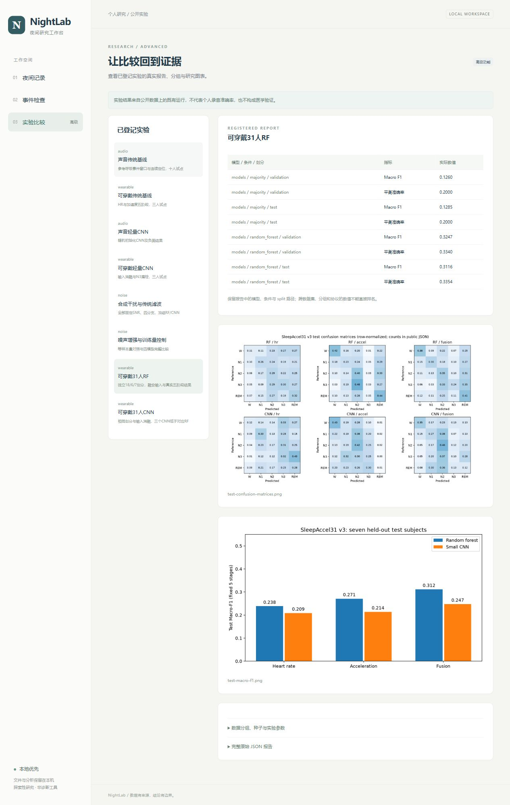

# 本地软件与通用个人导入验收

2026-10-26，Windows本机真实执行。本次验收覆盖Phase3、Phase4的通用导入/删除适配和Phase5的软件交付材料；不是医学、真人手机或手表设备验收。

## 自动检查

完整Python套件：504 passed、117 subtests passed、4 skipped，36.83秒。4项skip均为Windows实际符号链接创建需要OS权限；模拟恶意路径/归档、数据库回滚、格式、取消和完整性检查并未整体跳过。Starlette TestClient对httpx的弃用警告如实保留，当前锁定依赖下请求通过。pip check通过。

前端最终typecheck、lint、build均exit0；生产JS250.81kB/gzip79.02kB、CSS12.80kB/gzip3.65kB。依赖精确版本与lockfile入库，node_modules/dist忽略。新环境验收见INSTALLATION.md：全新独立CPU venv、无Torch、隔离npm ci/构建成功，使用了本机缓存，非空缓存新电脑验收。

API定向7项通过，包含坏导入无孤立文件/索引、Range206、局部谱图、用户标记与CSV公式保护、附件null、真实RF的HTTP→文件→SQLite→特征/模型→事件、尾部12.3秒两窗口覆盖、短音频拒绝、活动删除阻止、合作取消/旧结果保留、重启遗留任务恢复、受控实验图路径。存储/媒体另29通过1权限skip，附件解析10通过51subtests，31人新数据/训练测试也在总套件内。

## 主线程真实浏览器路径

使用隐藏的本机浏览器，静音验收，不外放合成音频。页面、上传、原生播放器和下载均经过实际操作，未用截图或HTTP200代替完整路径。

| 流程 | 实际结果与证据 |
|---|---|
| 空状态与Demo | 初始记录库0，生成确定性90秒本地Demo后显示synthetic标识、三段demo标记及演示时序，默认不播放 |
| WAV文件选择与上传 | 实际选择自建12.3秒32kHz双声道PCM24文件，显示上传/校验并入SQLite，原文件SHA/frames/声道正确 |
| 坏文件/错误提示 | 非WAV容器被拒绝，无记录/目录；未知JSON字段source被明确拒绝，改为公开模板meta.synthetic后成功，不猜字段 |
| 上传中断 | 实际TCP上传部分body后断开，记录数不变、staging清空；未把请求发出当导入完成 |
| 播放/定位 | 点选15–23秒Demo事件，播放器/波形/谱图定位；静音播放currentTime从15.418推进至32.595后暂停；另1–2秒“播放选段”实际到2秒自动暂停，readyState4 |
| JSON附件 | 实际上传模板结构，心率null、Unknown阶段、三轴缺口保留，并显示synthetic/非PSG警示 |
| 开始时间与跨午夜CSV | 浏览器录音起点23:59:58保存为含UTC时区ISO；ISO附件23:59:58、00:00:00、00:00:05映射0/2/7秒，API/SQLite字段复核一致 |
| 用户标记 | 1–2秒“合成用户观察”保存，source=user、无伪造得分；RF后再CNN分析仍保留 |
| 真实RF及CNN | 分别实际完成2/2窗口；CNN在CPU执行、可信权重版本06f672c24110，RF版本a20408410200。高分只是模型输出，不是合成音频准确率 |
| 导出 | 真正下载events.csv，读取确认含model_id/model_version与user/model来源，未用仅链接存在替代下载 |
| 取消任务 | 自建30分钟57,600,044字节WAV，真实359窗口RF任务点击取消，最终32/359窗口、status=cancelled，未发布部分事件；无GPU |
| 删除 | 浏览器先取消删除，文件/索引保留；再确认删除带音频/附件/用户与模型标记/完成任务的测试记录。之后查实际目录不存在及SQLite records/events/wearable/jobs关联均0，播放器释放 |
| 实验 | 页面读入真实31人RF/CNN与既有噪声报告；融合RF test Macro-F1显示.3116，图片来自登记的本地聚合图 |
| 响应式 | 390×844检查文档scrollWidth375≤innerWidth390；窄屏导航/记录/表格可用，无全页横向溢出，随后恢复默认视口 |

本次所有导入和删除对象均为本代理创建的synthetic验收记录，不涉及用户个人录音。验收过程中发现并修复：失败上传仍显示“正在校验”的进度、秒级datetime控件值未进入请求、模型事件缺少持久版本、服务重启任务永久running。相关API回归或真实浏览器复验完成。

实际浏览器聚合收据在`docs/results/app-browser-acceptance-v1.json`，没有私人逐行信号或测试UUID。截图实际拍摄并查看，无栅格编辑；来源/字节/SHA见`artifacts/screenshots/provenance.json`。

## 实际截图

## 当前边界

未取得本次用户真人录音或实际手表导出，因此只能声明通用适配和合成端到端验收，没有真人/厂商设备兼容结论。没有实际宿舍噪声、外部验证、医学验收，旧研究指标仍有大量漏检/误报。4GiB/24h为实现上限，本轮最大实际浏览器文件57.6MB/30分钟，不能声称已把4GiB/24h全规模跑过。

数据/权重只本地忽略；公开软件使用MIT，原始数据各自许可。删除非安全擦除，系统备份与导出不自动删除，极少见文件系统/DB提交故障边界见PRIVACY.md。Android录音与长上下文模型按原任务书是可选项，本轮未实现。整体研究/软件交付与真实个人设备试用应分别验收。

主线程随后实际通过start_app.ps1启动全新CPU venv（无Torch），读取同源生产前端，真实自有RF完成90秒Demo的17窗口分析，CNN明确因缺可选依赖不可用；确认删除后记录归零。收据见docs/results/app-fresh-cpu-start-v1.json。验收服务随后停止。

## 无数据的隔离公共检出

额外在隔离git checkout-index目录、全新无Torch CPU环境运行完整可用套件：405 passed、13 skipped、117 subtests passed（18.74秒）。跳过涉及可选Torch/本地自有模型与Windows符号链接权限，未下载数据或权重。先发现两个单元测试偷用本机intake receipt，已改为合成元信息夹具；正式数据校验没有放松。新增.gitattributes后151个源码/清单/报告/协议/锁/SVG在隔离检出与当前工作树逐字节相同。

最终补入可迁移绑定工具后的完整复查：本机504 passed、4 skipped、117 subtests passed（36.83秒）；无数据/无Torch隔离公共检出417 passed、13 skipped、117 subtests passed。新绑定器12项合成测试通过；主线程另在本机默认只读复核93个真实raw，already bound/no change，未修改既有manifest或实验。
