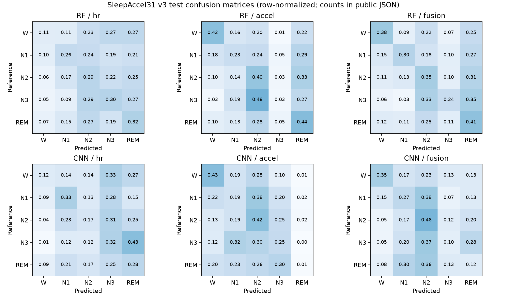

# SleepAccel31 v3 固定划分实验结果

2026-10-26。本次在新31人输入上完成心率、加速度和融合的随机森林与轻量CNN六个模型，以及每个模型的一次同seed独立复跑。融合RF测试Macro-F1为0.31161；三个CNN均低于对应RF。保留全部负面结果，没有据测试分数修改配置或再训练选择参数。这里的“六个模型”不含重复计算的多数类基线。

## 数据和选择边界

读取入口为 `python -m scripts.train.wearable31`；不带参数仅严格校验，不训练、不写文件。读取重新核对固定intake/plan/manifest链接、93个raw文件官方大小/SHA、当前规范化/提取源码摘要、两个complete corpus、31份classical与31份deep artifact摘要、身份/标签/时间逐项一致、NaN/观测mask语义、冻结18/6/7受试者分组，并实际重验旧三人exact parity。旧三人仅进入新训练集。监督行总计26,773，train/validation/test为16,126/4,422/6,225。

规范化依据 `WEARABLE_CLEANING_V3.md`，不存在域内timestamp冲突修补、插值、测试集拟合或随机epoch划分。经典输入13列；deep输入5×30值与2×30独立mask。标准化及RF中位数填补只拟合训练行；心率/加速度/融合分别拟合各自输入。原始数据、张量、均值/尺度、逐行预测和权重仅保存在忽略目录，公共JSON只提供聚合指标及来源摘要。

RF调用原 `scripts.train.baselines.run`，固定200棵树、max_depth12、min_samples_leaf3、balanced_subsample、seed42、n_jobs1。CNN复用原 `fit_pilot` 与 `DL_PROTOCOL.md`：seed42、AdamW、lr0.001、batch64、最多20epoch、patience5；严格提高validation Macro-F1才更新检查点，平分保留最早。测试只评价该检查点。CPU数值线程1，DataLoader子进程0；没有改旧runner、旧特征/deep实现或旧报告。

## 实际聚合指标

所有指标按固定W/N1/N2/N3/REM五类计算，Macro-F1包含所有五类。表格为受试者留出后的epoch汇总，不能将6,225个相关epoch当成6,225个独立的人。

| 模型 | 输入 | Validation Macro-F1 | Test Macro-F1 | Test平衡准确率 |
|---|---|---:|---:|---:|
| RF | 心率 | 0.29606 | 0.23836 | 0.25675 |
| RF | 加速度 | 0.25924 | 0.27118 | 0.30270 |
| RF | 融合 | 0.32468 | 0.31161 | 0.33539 |
| CNN | 心率 | 0.27278 | 0.20877 | 0.24456 |
| CNN | 加速度 | 0.28692 | 0.21391 | 0.26048 |
| CNN | 融合 | 0.28818 | 0.24739 | 0.26031 |
| 多数类N2 | 各版本一致 | 0.12602 | 0.12849 | 0.20000 |

多数类测试accuracy为0.47325，说明在类别不平衡时accuracy本身不足以判断分期能力。融合RF每类测试F1为W0.29315/N1 0.25600/N2 0.42741/N3 0.25496/REM0.32651。融合CNN为0.32999/0.16570/0.50229/0.10710/0.13187，N3和REM尤其弱。加速度CNN的REM召回率很低，完整数值与混淆矩阵保留在JSON，不因其不理想而删去。

## 实际资源与复现核验

先检查GPU进程，无其他Python/CUDA训练进程；仅顺序运行一个本项目训练进程，未更改系统电源、显卡设置或其他项目。CUDA smoke为320训练行加完整validation，未计算test指标，训练/评价总计2.254秒、峰值PyTorch张量显存70,169,600字节，真实保存加载概率逐项一致。事先报告的正式预算为六次CNN最多20epoch、10–20分钟量级；实际短于预算。

| CNN输入 | 最佳epoch | 实际停止epoch | 首次正式训练/评价秒数 | 峰值张量显存字节 |
|---|---:|---:|---:|---:|
| 心率 | 5 | 10 | 11.211 | 70,121,984 |
| 加速度 | 1 | 6 | 6.602 | 70,151,168 |
| 融合 | 4 | 9 | 9.640 | 70,169,600 |

首次RF拟合/评价为2.214/3.597/4.232秒（心率/加速度/融合）。全部12次正式执行报告中的训练/评价耗时相加73.680秒，不包含原始文件SHA读取、Python导入、序列化和外围开销，也不是总墙钟耗时。PyTorch峰值是已分配张量显存，不等于nvidia-smi所见的进程总显存。

三个CNN分别实际保存CPU state_dict，以weights_only=True加载到同一CUDA设备、相同batch，validation/test概率逐项完全相同。每个CNN再从头以seed42训练一次：除elapsed_seconds外的全部history、最佳epoch、指标、逐行概率/行索引、checkpoint字节SHA均完全相同。三个RF均比较拟合后的内存模型与joblib保存加载模型概率，再独立重拟合一次；指标、概率、checkpoint字节SHA全部一致。完整检查保留在每份公共JSON的 `same_seed_rerun`。

`tests/test_wearable31_training.py`实际16 passed，覆盖缺失不被填回、标签/身份/时间/mask/监督标志/形状/inf/额外字段拒绝，incomplete/重复记录/split/source/errors/version拒绝，以及公共报告剔除私有拟合和身份内容。正式批次exit0；批次结束再查GPU进程，无本项目Python训练进程残留。图由 `python -m scripts.evaluate.wearable31_figures` 根据六份真实聚合JSON重建，并已实际查看混淆矩阵图。

## 解释限制与接续

这只支持该公开数据集固定18/6/7划分、固定seed和当前设备/依赖上的实验结果。七个测试受试者规模仍小，未做跨seed统计、独立外部数据集、真实个人设备或医学验证，也未建立置信区间。复跑完全相同验证的是当前确定性流程，不能代表不同GPU/驱动下也会逐bit一致。

旧三人pilot的划分、训练规模和验证/测试身份不同，不能把旧分数与新分数直接当成模型进步/退步量。31人新RF与CNN共享本次冻结分组和标签；它们的表示不同（13维统计特征对5×30观测值），本次比较包含表示差异，不能单独归因于模型架构。后续如要尝试更长时间上下文或改模型，应先记录新的验证选择协议；不得根据本次测试结果反复调参后仍称其为未见测试集。

六份聚合文件位于 `docs/results/wearable31-{rf,cnn}-{hr,accel,fusion}-v3.json`；来源/结果摘要汇总见 `docs/results/wearable31-verification-v3.json`。私有运行分别位于 `runs/wearable31-*-v3[-repro]` 与 `models/wearable31-*-v3[-repro]`。旧raw、旧三人split、旧特征/深度输入、旧报告与旧训练源码均保持冻结。
